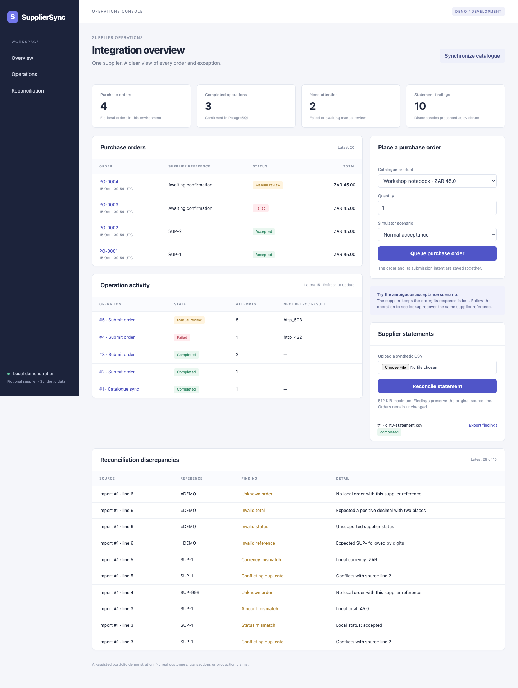
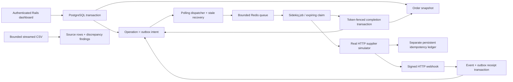

# SupplierSync

**An AI-assisted Rails portfolio demonstration of unreliable API integration, durable background work and reconciliation.** All supplier records, products, orders and statements are fictional. This project makes no claim of real customers, production scale or professional experience.

The central failure demonstration: a supplier persists an order, then delays its response beyond the HTTP timeout. SupplierSync records the uncertainty, schedules a retry and looks up the original idempotency key. It recovers the supplier reference without making a second submission.



## Run locally

The full implementation is on `feat/reliable-supplier-integration` until its review PR is merged. `main` intentionally contains the minimal runnable scaffold.

Prerequisites: Git, Docker Compose, Ruby **4.0.7** and Bundler. macOS and Linux are the intended development environments. No paid accounts or external credentials are required.

```sh
git clone https://github.com/HansieMuller/supplier-sync.git
cd supplier-sync
git switch feat/reliable-supplier-integration
ruby -v                         # must be 4.0.7
bundle install
docker compose up -d --wait
export PGHOST=127.0.0.1 PGPORT=55439 PGUSER=supplier_sync
export REDIS_URL=redis://127.0.0.1:56379/12
bin/setup
bin/dev
```

Open [http://127.0.0.1:3000](http://127.0.0.1:3000). In another terminal run `bin/demo-password`; log in as `operator` with the generated password. Secrets live only in ignored `tmp/demo-secrets.json` (mode 0600). Never commit that file. `bin/dev` starts Rails, the HTTP supplier, open-source Sidekiq and the polling dispatcher; Ctrl-C stops its children. Refresh pages to see new state.

Compose runs only PostgreSQL and Redis, with loopback port bindings and persistent local volumes. Its PostgreSQL trust authentication is exclusively for this local demo. It does not deploy the app. A running native PostgreSQL/Redis installation can also be used; set PGHOST/PGPORT/PGUSER and REDIS_URL accordingly. Use dedicated Redis databases.

| Component | Pinned version |
| --- | --- |
| Ruby / Rails | 4.0.7 / 8.1.4 |
| PostgreSQL / Redis containers | 17.11 / 8.2.10 |
| Sidekiq OSS / Puma | 8.1.7 / 8.0.2 |

Direct gem versions and `Gemfile.lock` are committed. GitHub Actions dependencies are pinned by commit. Rails 8.1 is in security maintenance through October 2027; reassess dependencies before any public deployment. Version sources: [Rails release](https://rubyonrails.org/2026/9/24/Rails-Version-8-1-4-has-been-released), [Rails maintenance](https://rubyonrails.org/maintenance), [Ruby release](https://www.ruby-lang.org/en/news/2026/09/15/ruby-4-0-7-released/), [PostgreSQL releases](https://www.postgresql.org/docs/17/release.html), [Redis release](https://github.com/redis/redis/releases/tag/8.2.10).

## Commands and configuration

Run these with the same PG*/REDIS_URL environment variables as setup:

| Command | Purpose |
| --- | --- |
| `bin/setup` | Install missing gems, prepare the DB and schedule synthetic catalogue seed work |
| `bin/dev` | Start the four app processes, bound locally |
| `bin/rails db:seed` | Idempotently schedule a catalogue synchronization |
| `bin/demo-password` | Display the local operator password explicitly |
| `bin/demo-event ORDER_ID` | Ask the simulator to send a real signed shipment webhook |
| `bin/rails test` | Behavior, HTTP and real competing PostgreSQL transaction tests; Redis DB 13 |
| `bin/smoke` | Separate processes against PostgreSQL, Redis DB 14 and actual HTTP |
| `bin/ci` | Tests, smoke, autoload, Brakeman and dependency audit |
| `bin/rails demo:reset` | Reset fictional supplier ledger and app records; see below |
| `ruby script/audit_publication.rb` | Scan all reachable Git blobs and tracked paths for publication hazards |

To reset: stop `bin/dev`, start `bin/supplier` alone in another terminal, then run `bin/rails demo:reset`. Stop the standalone supplier and restart `bin/dev`. This deletes only this demo's application records and supplier ledger. It does not delete Docker volumes. Resetting one side alone breaks the demo's retained-idempotency assumption. The catalogue seed runs through the queue after restart.

Separate process commands are `bin/supplier`, `bin/rails server -b 127.0.0.1`, `bundle exec sidekiq -C config/sidekiq.yml` and `bin/dispatch`. APP_PORT/PORT default to 3000; SUPPLIER_PORT defaults to 4567. Only ports are configurable for the provider: HTTP always targets literal `127.0.0.1`, disables environment proxies and follows no redirects. Fault controls are development/test only.

Tests force Redis database 13 on the configured Redis endpoint. Smoke forces database 14 (SMOKE_REDIS_URL can choose its endpoint) and the named `supplier_sync_smoke` database. It rejects DATABASE_URL and owns only its child processes. Smoke requires free loopback ports 3100 and 4569. Do not share these dedicated test databases with other applications. Logs stay in ignored `tmp/` and `log/`.

## Architecture and guarantees



This is one Rails modular monolith plus a local fictional HTTP provider, not a production service topology. The simulator's file ledger is deliberately outside Rails' database.

- **Atomic local intent:** an order snapshot and operation row commit together. An operation is both outbox intent and the authoritative work state; no extra generic event framework.
- **Delivery is separate from completion:** queued rows have a 60-second lease. A crash before or after Redis enqueue is recovered by the dispatcher. Abandoned running attempts consume their budget. Delivery tokens reject old jobs; claim tokens fence late completion. No database transaction remains open across HTTP.
- **One retry owner:** PostgreSQL allows five attempts per cycle. Sidekiq automatic retries are disabled. Backoff is exponential plus 0–1 second jitter; 429 honors numeric or HTTP-date Retry-After without worker sleeps. Deferrals beyond one day require operator attention instead of retrying earlier. 422 is permanent; ambiguous exhaustion and contract conflicts enter manual review. Up to three explicit operator retries grant fresh budgets while preserving order/key/payload and attempt numbering.
- **Bounds:** at most 200 active operations, 50 queued/running claims and 100 messages admitted to the Redis queue by the application. Admission races use PostgreSQL advisory/row locks and an atomic Redis script. Sidekiq runs two threads per process; the global outstanding-claim bound also limits multiple processes. The supplied runner starts one Sidekiq process. Stock Sidekiq shutdown recovery may requeue its two in-flight messages above the producer limit; that small transient surplus is an explicit transport limitation. No paid uniqueness, cron or reliable-fetch features.
- **Supplier assumptions:** the simulator retains every submitted key/payload, rejects changed payloads even after a rejection, and supports authoritative lookup. Every submission attempt looks up first. When those provider guarantees or retention are unavailable, an ambiguous result may need manual supplier review. Never replace a key merely to escape uncertainty.
- **No exactly-once claim:** jobs and HTTP requests may execute more than once; queues can lose deliveries. Durable intent plus recovery aims for eventual processing while services and retention remain available. Idempotency limits duplicate supplier effects under the stated contract. See Sidekiq's [best practices](https://github.com/sidekiq/sidekiq/wiki/Best-Practices) and [OSS reliability limits](https://github.com/sidekiq/sidekiq/wiki/Reliability).

## Webhooks and reconciliation

HMAC-SHA256 signs `timestamp.raw_request_bytes`. The app compares fixed-length signatures in constant time, accepts at most five minutes of timestamp skew, validates field types/UTF-8 and commits the unique event and its operation before HTTP 202. Duplicate event IDs require byte-identical bodies. Expired retries must be re-signed with a current timestamp; event identity still deduplicates them. No browser password or CSRF bypass is used for operator actions; only the signed webhook endpoint has a scoped CSRF exemption.

Higher supplier versions win, lower versions are recorded as ignored, and an equal version must agree on status. Thus a higher version is authoritative even if its status appears to move backwards; equal-version disagreement enters manual review. Unknown supplier references are preserved for review, including webhooks arriving before order acceptance recovery. Requeue that same event operation after its reference becomes known. The simulator's `/emit` control sends actual signed HTTP, with no arbitrary callback URL.

Statement uploads are evidence snapshots and never update orders. UTF-8 CSV has four exact headers (`reference,status,currency,total`) and one record per physical line. Limits: 512 KiB/file, 2,000 data rows, 2,048 bytes/line, four fields, 256 bytes/field. Quoted multiline records, NUL bytes and invalid encoding are rejected. Rows preserve source text, import digest and physical line number. Findings cover invalid data, conflicting duplicates within a file, unknown orders, and currency/amount/status mismatches. Decimal totals use PostgreSQL numeric/BigDecimal, never float. An identical file returns the existing import/findings, even if local orders later change. Invalid files retain bounded partial provenance with a failed state. Exports prefix potential spreadsheet formulas with an apostrophe.

## Five-minute interview demonstration

1. **0:00–0:45 — Orient.** Show the synthetic-data notice, three catalogue products and operations. Explain the order/outbox transaction and separate provider ledger.
2. **0:45–2:00 — Lose a response.** Choose **Accept, then time out** and queue one notebook. Refresh and open its PO link. The first attempt records `Net::ReadTimeout`; after the scheduled retry the operation completes with one supplier reference. Show the immutable key and two attempts. Explain lookup-before-submit and why enqueue success is insufficient.
3. **2:00–2:45 — Classify failures.** Queue **Rate limit once (429)**, then **Validation rejected (422)**. Show scheduled retry versus terminal failure. The retry button keeps the original operation; it cannot edit the payload or key.
4. **2:45–3:30 — Apply a shipment.** Run `bin/demo-event ORDER_ID` for the accepted order. Refresh to see `shipped`. Explain signed bytes, receipt-before-acknowledgement, unique event IDs and version ordering.
5. **3:30–4:30 — Reconcile dirty data.** Upload `demo/dirty-statement.csv`, inspect findings/source lines, export the safe CSV, and upload it again. Counts remain stable. Explain why discrepancies do not silently repair business records. Reference SUP-1 is synthetic; after previous runs, unknown-reference findings are expected.
6. **4:30–5:00 — Show evidence and limits.** Open the [failure-mode map](docs/failure-modes.md), CI results and smoke command. Explain retention assumptions, manual review and the absence of an exactly-once guarantee.

## Code paths to understand

| Start here | Interview topic |
| --- | --- |
| `PurchaseOrder.place!` → `Operation.admit!` | Immutable prices/payload; transactional outbox; admission rollback |
| `OutboxDispatcher.claim/tick` → `BoundedQueue.push` | Competing dispatchers; enqueue loss windows; physical queue bound |
| `OperationJob.perform` → `Operation.claim!/finish!` | HTTP outside transactions; duplicate jobs; lease recovery; fenced completion; retry ownership |
| `SupplierClient.lookup/submit` → `simulator/app.rb` | Provider contract, response loss, timeouts, permanent/transient errors |
| `CatalogueSync.schedule!/run!` | Coalesced runs, bounded pagination, per-page checkpoints, stale-claim guards |
| `WebhooksController` → `WebhookEvent.accept!/apply!` | Raw-body authentication, replay tolerance, unique receipt, serialized version updates |
| `StatementImport.process!/read_rows!` → `StatementExport` | Streaming limits, provenance, repeat identity, decimal comparison, safe exports |

[Changelog](CHANGELOG.md) records the release scope.

The hardest tradeoffs are documented in [design decisions](docs/design-decisions.md). The test map names exact scenarios and executable commands; [verification evidence](docs/verification.md) distinguishes local runs from hosted CI.

## Limits before public deployment

This is local educational software, not deployment-ready infrastructure. Further work would include independent security review, real user/session/role management, TLS and credential rotation, ingress/body/rate limits (including chunked uploads), audit retention and backups, operational alerting, provider retention/SLA confirmation and infrastructure hardening. The dev simulator trusts a fictional single-supplier contract and uses a single-host file ledger; it is not a production provider implementation. No load/chaos campaign, HA failover or production-scale claim is established. The bounded listings intentionally show recent records without a full search/archive UI. Statement imports run synchronously under strict small-file limits.

Do not attach this to applications until the code and failure demonstrations receive an independent review. The implementation PR remains open; nothing is automatically merged or deployed.
